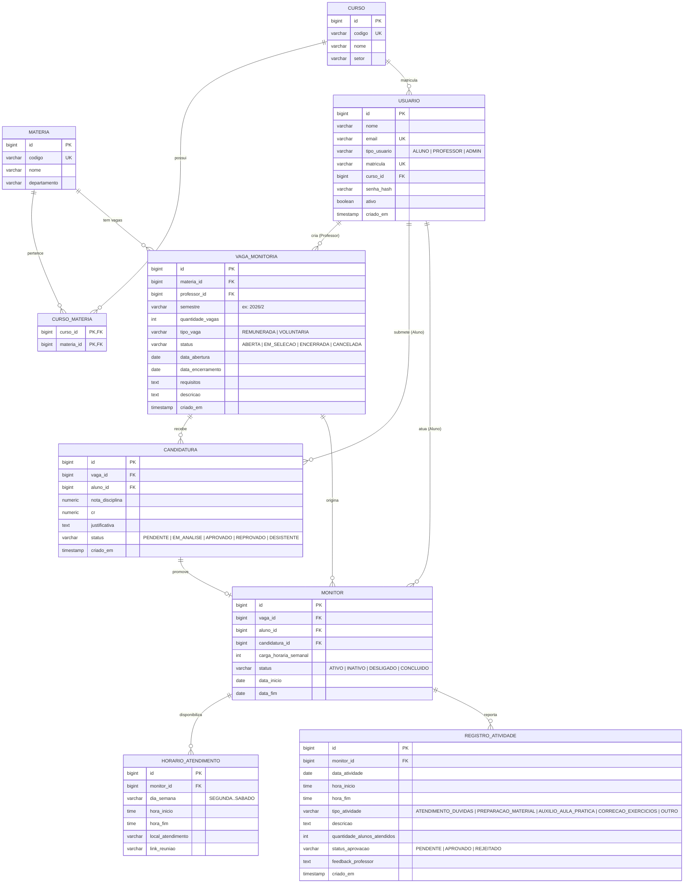

# Modelagem do Banco de Dados

Esquema relacional criado pelas migrações Flyway `V1` a `V4` em `backend/src/main/resources/db/migration/`.

## 1. Diagrama Entidade-Relacionamento

## 2. Dicionário das tabelas (`V1`–`V4`)

### `cursos`

| Coluna | Tipo e restrições | Observação |
| --- | --- | --- |
| `id` | `BIGSERIAL PRIMARY KEY` | |
| `codigo` | `VARCHAR(20) NOT NULL UNIQUE` | Ex.: `BCC`, `IBM`, `MAT`, `EST` |
| `nome` | `VARCHAR(150) NOT NULL` | |
| `setor` | `VARCHAR(100) DEFAULT 'Setor de Ciências Exatas'` | |

### `materias`

| Coluna | Tipo e restrições | Observação |
| --- | --- | --- |
| `id` | `BIGSERIAL PRIMARY KEY` | |
| `codigo` | `VARCHAR(20) NOT NULL UNIQUE` | Ex.: `CI1055`, `CM041` |
| `nome` | `VARCHAR(150) NOT NULL` | |
| `departamento` | `VARCHAR(100) NOT NULL` | Ex.: `DInf - Departamento de Informática` |

### `cursos_materias`

Associação N:N com chave primária composta `(curso_id, materia_id)`. Ambas são `BIGINT NOT NULL` referenciando `cursos(id)` e `materias(id)` com `ON DELETE CASCADE`.

### `usuarios`

| Coluna | Tipo e restrições | Observação |
| --- | --- | --- |
| `id` | `BIGSERIAL PRIMARY KEY` | |
| `nome` | `VARCHAR(150) NOT NULL` | |
| `email` | `VARCHAR(150) NOT NULL UNIQUE` | Validado como `@Email` na API |
| `tipo_usuario` | `VARCHAR(30) NOT NULL CHECK (...)` | `ALUNO`, `PROFESSOR` ou `ADMIN` |
| `matricula` | `VARCHAR(50) UNIQUE` | GRR ou matrícula funcional (Siape) |
| `curso_id` | `BIGINT REFERENCES cursos(id) ON DELETE SET NULL` | Opcional |
| `senha_hash` | `VARCHAR(255) NOT NULL` | Adicionada na `V3` (hash BCrypt) |
| `ativo` | `BOOLEAN NOT NULL DEFAULT TRUE` | |
| `criado_em` | `TIMESTAMPTZ DEFAULT CURRENT_TIMESTAMP` | |

### `vagas_monitoria`

| Coluna | Tipo e restrições | Observação |
| --- | --- | --- |
| `id` | `BIGSERIAL PRIMARY KEY` | |
| `materia_id` | `BIGINT NOT NULL REFERENCES materias(id) ON DELETE RESTRICT` | |
| `professor_id` | `BIGINT NOT NULL REFERENCES usuarios(id) ON DELETE RESTRICT` | |
| `semestre` | `VARCHAR(10) NOT NULL` | Ex.: `2026/2` |
| `quantidade_vagas` | `INT NOT NULL DEFAULT 1 CHECK (quantidade_vagas > 0)` | |
| `tipo_vaga` | `VARCHAR(30) NOT NULL CHECK (...)` | `REMUNERADA`, `VOLUNTARIA` |
| `requisitos` | `TEXT` | |
| `descricao` | `TEXT` | |
| `status` | `VARCHAR(20) NOT NULL DEFAULT 'ABERTA' CHECK (...)` | `ABERTA`, `EM_SELECAO`, `ENCERRADA`, `CANCELADA` |
| `data_abertura` | `DATE` | Adicionada na `V4` |
| `data_encerramento` | `DATE` | Adicionada na `V4`; `chk_vaga_periodo_inscricao` exige `data_encerramento >= data_abertura` quando ambas preenchidas |
| `criado_em` | `TIMESTAMPTZ DEFAULT CURRENT_TIMESTAMP` | |

### `candidaturas`

| Coluna | Tipo e restrições | Observação |
| --- | --- | --- |
| `id` | `BIGSERIAL PRIMARY KEY` | |
| `vaga_id` | `BIGINT NOT NULL REFERENCES vagas_monitoria(id) ON DELETE CASCADE` | |
| `aluno_id` | `BIGINT NOT NULL REFERENCES usuarios(id) ON DELETE CASCADE` | `uq_candidatura_vaga_aluno` garante unicidade em `(vaga_id, aluno_id)` |
| `nota_disciplina` | `NUMERIC(4,2) CHECK (0..100)` | Opcional |
| `cr` | `NUMERIC(4,2) CHECK (0..100)` | Opcional |
| `justificativa` | `TEXT` | |
| `status` | `VARCHAR(20) NOT NULL DEFAULT 'PENDENTE' CHECK (...)` | `PENDENTE`, `EM_ANALISE`, `APROVADO`, `REPROVADO`, `DESISTENTE` |
| `criado_em` | `TIMESTAMPTZ DEFAULT CURRENT_TIMESTAMP` | |

### `monitores`

| Coluna | Tipo e restrições | Observação |
| --- | --- | --- |
| `id` | `BIGSERIAL PRIMARY KEY` | |
| `vaga_id` | `BIGINT NOT NULL REFERENCES vagas_monitoria(id) ON DELETE RESTRICT` | |
| `aluno_id` | `BIGINT NOT NULL REFERENCES usuarios(id) ON DELETE RESTRICT` | `uq_monitor_vaga_aluno` garante unicidade em `(vaga_id, aluno_id)` |
| `candidatura_id` | `BIGINT REFERENCES candidaturas(id) ON DELETE SET NULL` | Opcional; associação 0..1 mantida pela regra de negócio (sem `UNIQUE` na coluna em SQL) |
| `carga_horaria_semanal` | `INT NOT NULL DEFAULT 12 CHECK (carga_horaria_semanal > 0)` | |
| `status` | `VARCHAR(20) NOT NULL DEFAULT 'ATIVO' CHECK (...)` | `ATIVO`, `INATIVO`, `DESLIGADO`, `CONCLUIDO` |
| `data_inicio` | `DATE NOT NULL` | |
| `data_fim` | `DATE` | |

### `horarios_atendimento`

| Coluna | Tipo e restrições | Observação |
| --- | --- | --- |
| `id` | `BIGSERIAL PRIMARY KEY` | |
| `monitor_id` | `BIGINT NOT NULL REFERENCES monitores(id) ON DELETE CASCADE` | |
| `dia_semana` | `VARCHAR(20) NOT NULL CHECK (...)` | `SEGUNDA`, `TERCA`, `QUARTA`, `QUINTA`, `SEXTA`, `SABADO` |
| `hora_inicio` | `TIME NOT NULL` | |
| `hora_fim` | `TIME NOT NULL` | `chk_horario_ordem` exige `hora_fim > hora_inicio` |
| `local_atendimento` | `VARCHAR(150) NOT NULL` | |
| `link_reuniao` | `VARCHAR(255)` | Opcional |

### `registros_atividades`

| Coluna | Tipo e restrições | Observação |
| --- | --- | --- |
| `id` | `BIGSERIAL PRIMARY KEY` | |
| `monitor_id` | `BIGINT NOT NULL REFERENCES monitores(id) ON DELETE CASCADE` | |
| `data_atividade` | `DATE NOT NULL` | |
| `hora_inicio` | `TIME NOT NULL` | |
| `hora_fim` | `TIME NOT NULL` | `chk_registro_horario` exige `hora_fim > hora_inicio` |
| `tipo_atividade` | `VARCHAR(50) NOT NULL CHECK (...)` | `ATENDIMENTO_DUVIDAS`, `PREPARACAO_MATERIAL`, `AUXILIO_AULA_PRATICA`, `CORRECAO_EXERCICIOS`, `OUTRO` |
| `descricao` | `TEXT NOT NULL` | |
| `quantidade_alunos_atendidos` | `INT DEFAULT 0 CHECK (quantidade_alunos_atendidos >= 0)` | |
| `status_aprovacao` | `VARCHAR(20) NOT NULL DEFAULT 'PENDENTE' CHECK (...)` | `PENDENTE`, `APROVADO`, `REJEITADO` |
| `feedback_professor` | `TEXT` | |
| `criado_em` | `TIMESTAMPTZ DEFAULT CURRENT_TIMESTAMP` | |

## 3. Índices criados na `V1`

`idx_usuarios_email`, `idx_usuarios_matricula`, `idx_vagas_materia`, `idx_vagas_semestre`, `idx_candidaturas_vaga`, `idx_candidaturas_aluno`, `idx_monitores_aluno`, `idx_horarios_monitor` e `idx_atividades_monitor`.
