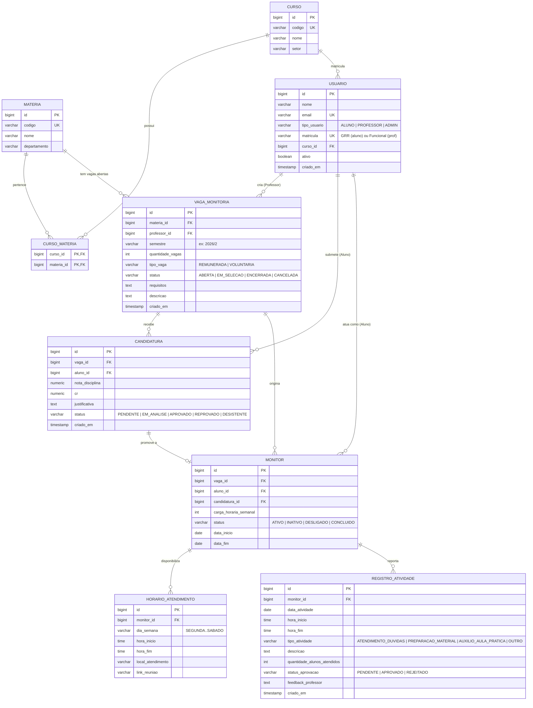

# Modelagem do Banco de Dados — Sistema de Monitoria UFPR

Este documento detalha o Modelo Entidade-Relacionamento (MER) e o Dicionário de Dados do Sistema de Monitoria Acadêmica (Setor de Ciências Exatas - UFPR), projetado com base na especificação da disciplina e no tema proposto:
> *"Sistema para gerenciar vagas de monitoria, candidaturas, seleção de alunos, horários de atendimento e registro das atividades realizadas pelos monitores."*

---

## 1. Visão Geral das Entidades e Relacionamentos

---

## 2. Dicionário de Dados

### 2.1. Tabela `cursos`
Armazena os cursos de graduação/pós-graduação atendidos pelo sistema.
* **`id`** (`BIGSERIAL`, PK): Identificador único do curso.
* **`codigo`** (`VARCHAR(20)`, UNIQUE, NOT NULL): Sigla institucional (ex: `'BCC'`, `'IBM'`, `'MAT'`).
* **`nome`** (`VARCHAR(150)`, NOT NULL): Nome completo do curso.
* **`setor`** (`VARCHAR(100)`): Setor acadêmico (ex: `'Setor de Ciências Exatas'`).

### 2.2. Tabela `materias`
Disciplinas ofertadas pelos departamentos.
* **`id`** (`BIGSERIAL`, PK): Identificador da matéria.
* **`codigo`** (`VARCHAR(20)`, UNIQUE, NOT NULL): Código da disciplina na UFPR (ex: `'CI1055'`, `'CM041'`).
* **`nome`** (`VARCHAR(150)`, NOT NULL): Nome da matéria (ex: `'Algoritmos e Estruturas de Dados 1'`).
* **`departamento`** (`VARCHAR(100)`, NOT NULL): Departamento responsável (ex: `'DInf'`, `'DMat'`).

### 2.3. Tabela associativa `cursos_materias`
Relaciona disciplinas aos cursos em que são ofertadas (relação N:N).
* **`curso_id`** (`BIGINT`, PK, FK): Referência a `cursos(id)`.
* **`materia_id`** (`BIGINT`, PK, FK): Referência a `materias(id)`.

### 2.4. Tabela `usuarios`
Centraliza os atores do sistema (Alunos, Professores e Administradores).
* **`id`** (`BIGSERIAL`, PK): Identificador único do usuário.
* **`nome`** (`VARCHAR(150)`, NOT NULL): Nome completo.
* **`email`** (`VARCHAR(150)`, UNIQUE, NOT NULL): E-mail institucional (@ufpr.br).
* **`tipo_usuario`** (`VARCHAR(30)`, NOT NULL): `ALUNO`, `PROFESSOR` ou `ADMIN`.
* **`matricula`** (`VARCHAR(50)`, UNIQUE): GRR para alunos (ex: `'GRR20231234'`) ou Matrícula Siape/Funcional para docentes.
* **`curso_id`** (`BIGINT`, FK, NULL): Curso de vínculo principal (aplicável primariamente a alunos).
* **`ativo`** (`BOOLEAN`, NOT NULL, DEFAULT TRUE): Estado de ativação da conta.
* **`criado_em`** (`TIMESTAMP WITH TIME ZONE`, DEFAULT CURRENT_TIMESTAMP).

### 2.5. Tabela `vagas_monitoria`
Editais/oportunidades de monitoria abertas por professores para determinada matéria e período letivo.
* **`id`** (`BIGSERIAL`, PK): Identificador da vaga.
* **`materia_id`** (`BIGINT`, FK, NOT NULL): Disciplina ofertada.
* **`professor_id`** (`BIGINT`, FK, NOT NULL): Professor orientador/responsável.
* **`semestre`** (`VARCHAR(10)`, NOT NULL): Período letivo (ex: `'2026/2'`).
* **`quantidade_vagas`** (`INT`, NOT NULL, CHECK > 0): Número de monitores a selecionar.
* **`tipo_vaga`** (`VARCHAR(30)`, NOT NULL): `'REMUNERADA'` ou `'VOLUNTARIA'`.
* **`requisitos`** (`TEXT`): Critérios necessários (ex.: aprovação prévia com nota $\ge 70$, etc.).
* **`descricao`** (`TEXT`): Descrição das atribuições esperadas.
* **`status`** (`VARCHAR(20)`, NOT NULL): `'ABERTA'`, `'EM_SELECAO'`, `'ENCERRADA'`, `'CANCELADA'`.
* **`criado_em`** (`TIMESTAMP WITH TIME ZONE`, DEFAULT CURRENT_TIMESTAMP).

### 2.6. Tabela `candidaturas`
Inscrições dos estudantes em vagas de monitoria com dados para processo seletivo.
* **`id`** (`BIGSERIAL`, PK): Identificador da candidatura.
* **`vaga_id`** (`BIGINT`, FK, NOT NULL): Vaga pretendida.
* **`aluno_id`** (`BIGINT`, FK, NOT NULL): Aluno candidato (UNIQUE par `vaga_id, aluno_id`).
* **`nota_disciplina`** (`NUMERIC(4,2)`): Nota final obtida anteriormente na disciplina (0 a 100).
* **`cr`** (`NUMERIC(4,2)`): Coeficiente de Rendimento geral do aluno.
* **`justificativa`** (`TEXT`): Carta de motivação / horários livres.
* **`status`** (`VARCHAR(20)`, NOT NULL): `'PENDENTE'`, `'EM_ANALISE'`, `'APROVADO'`, `'REPROVADO'`, `'DESISTENTE'`.
* **`criado_em`** (`TIMESTAMP WITH TIME ZONE`, DEFAULT CURRENT_TIMESTAMP).

### 2.7. Tabela `monitores`
Registra a atuação formal do aluno como monitor ativo para uma vaga selecionada.
* **`id`** (`BIGSERIAL`, PK): Identificador do monitor.
* **`vaga_id`** (`BIGINT`, FK, NOT NULL): Vaga vinculada.
* **`aluno_id`** (`BIGINT`, FK, NOT NULL): Aluno monitor.
* **`candidatura_id`** (`BIGINT`, FK, NULL): Candidatura de origem.
* **`carga_horaria_semanal`** (`INT`, NOT NULL, DEFAULT 12): Horas semanais contratuais.
* **`status`** (`VARCHAR(20)`, NOT NULL): `'ATIVO'`, `'INATIVO'`, `'DESLIGADO'`, `'CONCLUIDO'`.
* **`data_inicio`** (`DATE`, NOT NULL): Início da vigência da monitoria.
* **`data_fim`** (`DATE`): Término da vigência.

### 2.8. Tabela `horarios_atendimento`
Grade de horários semanais em que o monitor fica disponível para atendimento aos alunos.
* **`id`** (`BIGSERIAL`, PK): Identificador do horário.
* **`monitor_id`** (`BIGINT`, FK, NOT NULL): Monitor responsável.
* **`dia_semana`** (`VARCHAR(20)`, NOT NULL): `'SEGUNDA'`, `'TERCA'`, `'QUARTA'`, `'QUINTA'`, `'SEXTA'`, `'SABADO'`.
* **`hora_inicio`** (`TIME`, NOT NULL): Início do atendimento.
* **`hora_fim`** (`TIME`, NOT NULL): Término do atendimento (`hora_fim > hora_inicio`).
* **`local_atendimento`** (`VARCHAR(150)`, NOT NULL): Local físico (ex: `'Lab 3 DInf'`) ou indicação de online.
* **`link_reuniao`** (`VARCHAR(255)`): Link para sala virtual (Teams/Meet), se aplicável.

### 2.9. Tabela `registros_atividades`
Relatório das atividades realizadas pelos monitores para comprovação e validação pelo professor orientador.
* **`id`** (`BIGSERIAL`, PK): Identificador do registro.
* **`monitor_id`** (`BIGINT`, FK, NOT NULL): Monitor executor.
* **`data_atividade`** (`DATE`, NOT NULL): Data em que a atividade ocorreu.
* **`hora_inicio`** (`TIME`, NOT NULL): Início da atividade.
* **`hora_fim`** (`TIME`, NOT NULL): Fim da atividade.
* **`tipo_atividade`** (`VARCHAR(50)`, NOT NULL): `'ATENDIMENTO_DUVIDAS'`, `'PREPARACAO_MATERIAL'`, `'AUXILIO_AULA_PRATICA'`, `'CORRECAO_EXERCICIOS'`, `'OUTRO'`.
* **`descricao`** (`TEXT`, NOT NULL): Detalhamento do que foi realizado e tópicos abordados.
* **`quantidade_alunos_atendidos`** (`INT`, DEFAULT 0): Número de alunos atendidos no período.
* **`status_aprovacao`** (`VARCHAR(20)`, NOT NULL, DEFAULT `'PENDENTE'`): `'PENDENTE'`, `'APROVADO'`, `'REJEITADO'`.
* **`feedback_professor`** (`TEXT`): Parecer ou observações do professor orientador.
* **`criado_em`** (`TIMESTAMP WITH TIME ZONE`, DEFAULT CURRENT_TIMESTAMP).

---

## 3. Rastreabilidade com os Requisitos do Projeto

| Requisito do Tema / Sistema | Entidades Responsáveis |
| :--- | :--- |
| **Vagas de monitoria** | `vagas_monitoria`, `materias`, `usuarios` (Professor) |
| **Candidaturas de alunos** | `candidaturas`, `usuarios` (Aluno) |
| **Seleção de alunos** | Transição de status em `candidaturas` $\rightarrow$ criação de registro em `monitores` |
| **Horários de atendimento** | `horarios_atendimento`, `monitores` |
| **Registro das atividades realizadas** | `registros_atividades`, validação com `usuarios` (Professor) |
